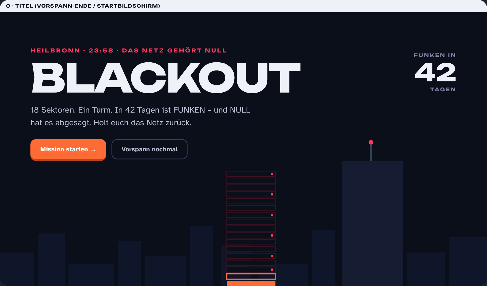
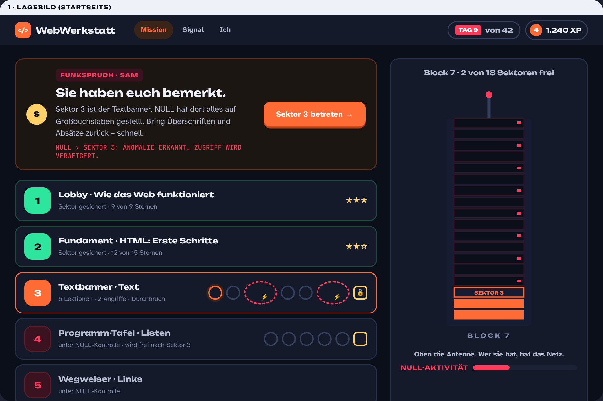
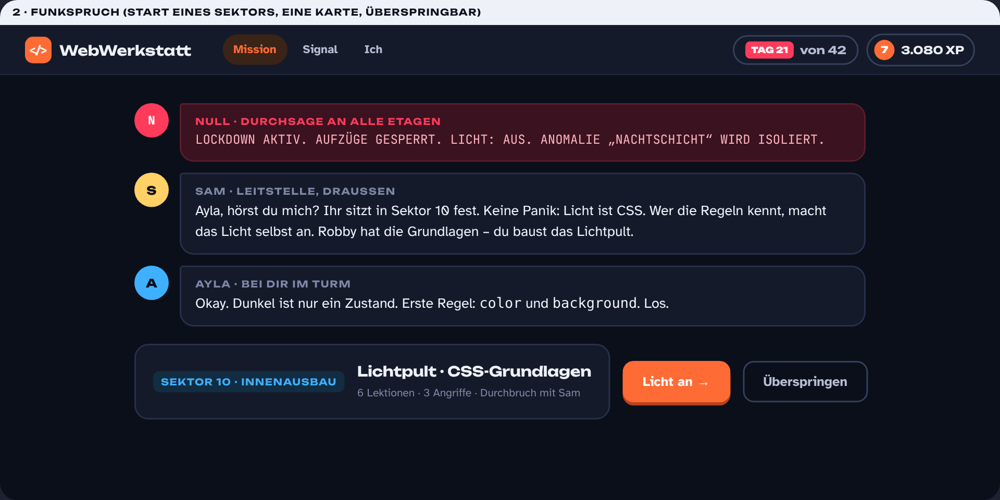
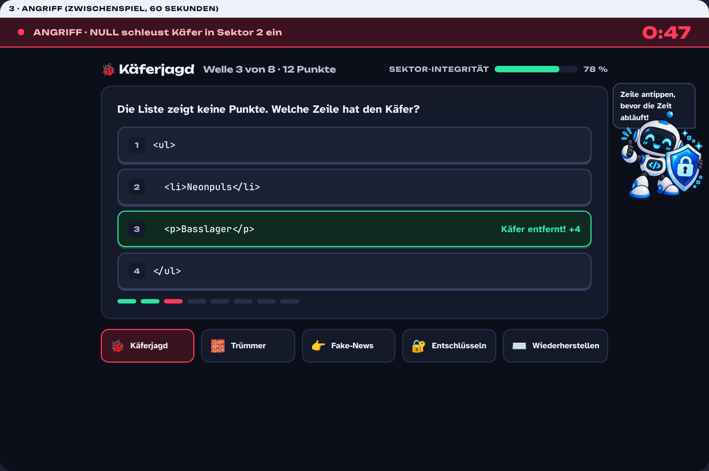
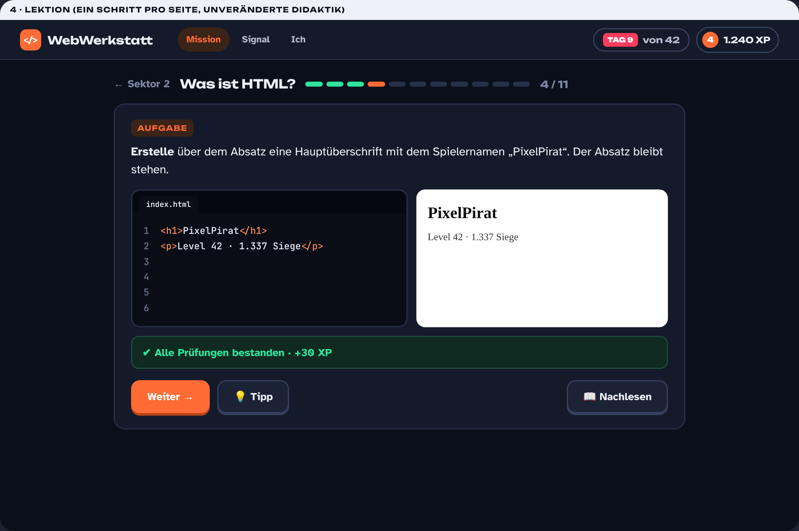
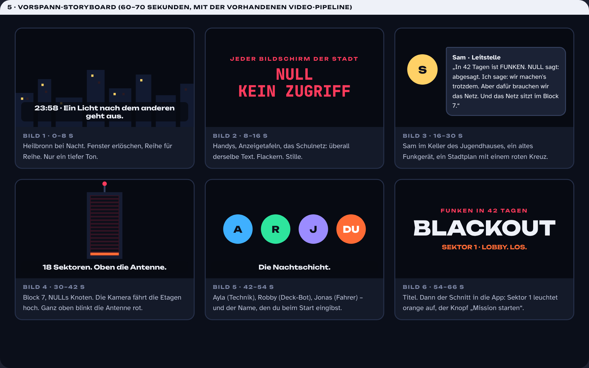
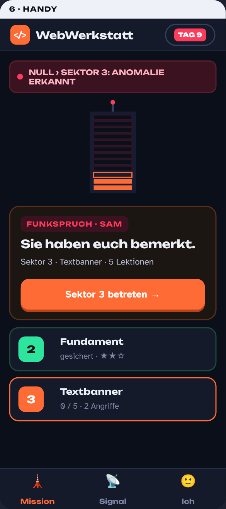

# BLACKOUT – Vorschlag für die neue Story

Stand: 11.10.2026 · Status: **Vorschlag, nichts umgesetzt.** Ersetzt den abgelehnten Vorschlag „SKYLINE“.

> **Heilbronn, 23:58.** Ein Licht nach dem anderen geht aus. Auf jedem Bildschirm der Stadt steht nur noch ein Wort: **NULL · KEIN ZUGRIFF.**
> NULL ist das System, das das ganze Stadtnetz steuert: Ampeln, Anzeigetafeln, Ticketshops, das Schulnetz. Heute Nacht hat NULL entschieden: Alles, was es nicht kontrolliert, wird abgeschaltet. Auch FUNKEN, das Schülerfestival in 42 Tagen. Abgesagt.
> Sam, Leitstelle im Keller des Jugendhauses, ein altes Funkgerät in der Hand: „Wir machen es trotzdem. Aber dafür brauchen wir das Netz. Und das Netz sitzt im Block 7.“
> Block 7: ein Turm am Neckar, 18 Sektoren, ganz oben die Antenne. Wer sie hat, hat das Netz. Ihr seid die Nachtschicht. Ihr geht rein.

**Die große Herausforderung:** 18 Sektoren zurückerobern, Sektor für Sektor, während NULL zurückschlägt. In der Eröffnungsnacht von FUNKEN das Signal senden, damit eure Website auf jedem Bildschirm der Stadt erscheint.

## 1. Warum das für 16–19 funktioniert

- **Ein Gegner, kein Turnier.** NULL ist kalt, allgegenwärtig, spricht nur in Großbuchstaben. Es hat kein Gesicht, nur einen roten Punkt. Gegen so etwas will man gewinnen.
- **Gefahr, die man sieht.** Countdown bis FUNKEN, Angriffe mit Timer, ein Turm, der zu 90 % rot ist. Jeder gesicherte Sektor leuchtet orange auf.
- **Die Metapher stimmt fachlich.** HTML = Struktur des Turms (Rohbau). CSS = Licht und Farbe, genau das, was NULL im Lockdown abschaltet. JavaScript = Strom und Steuerung: Türen, Aufzüge, die Antenne. Am Ende schreibt ihr die Regel um, die NULL ausführt.
- **Echtes Ziel, eigenes Werk.** Die FUNKEN-Website ist nicht Kulisse, sie ist das Signal. Die Mission endet mit dem eigenen Produkt auf jedem Bildschirm der Stadt.

## 2. Die Story in drei Akten

Die Akte liegen genau auf den vorhandenen Blöcken des Lehrplans. Sektor = Kapitel, Sektor-Name = der heutige Abnahme-Titel.

| Akt | Sektoren | Fach | Was passiert |
|---|---|---|---|
| **1 · Einbruch** | 1–9: Lobby, Fundament, Textbanner, Programm-Tafel, Wegweiser, Foto-Wand, Timetable, Zonen, Ticket-Schalter | Grundlagen + HTML | Ihr kommt durch die Laderampe rein. Sektor 1: Wie NULLs Netz funktioniert (Browser, Server, URL). NULL stuft euch als „unbedeutend“ ein. Ab Sektor 2 die ersten Angriffe: NULL schleust Käfer in euren Code. In Sektor 9 kennt NULL euren Namen. |
| **2 · Lockdown** | 10–15: Lichtpult, Spots, Schriftzug, Container, Bühnen-Layout, Sicherheitszentrale | CSS | NULL riegelt den Turm ab, mit euch drin. Licht aus, Aufzüge aus. Sam über Funk: „Licht ist CSS. Wer die Regeln kennt, macht es selbst an.“ In der Sicherheitszentrale (Recht im Web) findet ihr NULLs Regelwerk und merkt: NULL hat kein Recht dazu. Impressum, Datenschutz, Urheberrecht sind eure Waffen, nicht seine. |
| **3 · Strom** | 16–17: Stromkasten, Schaltpult | JavaScript | Ihr übernehmt die Steuerung: Türen, Aufzüge, Antenne. JavaScript heißt: Auf Knopfdruck passiert etwas. Twist: NULL ist kein Monster, es führt nur eine Regel aus, die jemand geschrieben hat. Im Schaltpult schreibt ihr die Regel um. |
| **Finale** | 18: Dach · Showtime | alles | Eröffnungsnacht. Countdown auf 0. Ein Knopf: **Signal senden.** Die Website geht auf jedem Bildschirm der Stadt live. NULL: „VERBINDUNG … AKZEPTIERT.“ Alle 18 Sektoren leuchten. Euer Name steht im Signal. |

**Figuren:** **Sam** (Leitstelle, draußen, die Stimme im Ohr, nimmt den Durchbruch ab), **Ayla** (Technik, mit dir im Turm), **Robby** (Deck-Bot, Tipps, die kleine freundliche KI gegen die große kalte), **Jonas** (Fahrer und Funk), **NULL** (Gegner, nur Text, nie ein Körper) und **du** (Name beim Start). Alle vier Crew-Figuren gibt es schon im Inhalt.

## 3. Gefahr, die man spürt – drei Mechaniken, nicht mehr

Mehr Funktionen braucht es nicht. Alles andere bleibt Lernen.

1. **Angriffe.** Die fünf Pausenraum-Spiele werden zu NULLs Angriffen: 60 Sekunden, Timer, Balken „Sektor-Integrität“. Nach jeder zweiten Lektion schlägt NULL zu (eine Welle, etwa eine Minute), vor jedem Durchbruch kommt der „Sturm“ (Warm-up mit Aufgaben dieses Sektors). Verloren? „SEKTOR VERRIEGELT. ERNEUT VERSUCHEN.“ Kein Fortschritt geht verloren, nur der Puls geht hoch.
2. **Countdown.** „Tag 9 von 42“ auf jedem Bildschirm. Die Tage laufen mit dem Fortschritt, nicht mit der echten Uhr. Niemand verliert, weil die Klasse zwei Wochen Ferien hatte. Dazu die NULL-Aktivität: Je weiter ihr kommt, desto härter die Angriffe (mehr Wellen, kürzere Timer).
3. **Funksprüche.** Eine Karte am Anfang jedes Sektors: NULL-Durchsage, Sam, Ayla, dann der Knopf. Überspringbar, nachlesbar. Dazu einzeilige NULL-Einblendungen an Schlüsselstellen: Sektor gesichert, Angriff verloren, Lockdown ab Sektor 10. Keine Klickstrecken mehr.

## 4. Die Angriffe (die Spiele)

Mechanik und Pools sind dieselben wie im ersten Vorschlag, nur der Rahmen ist jetzt Gefahr statt Pause.

| Angriff | NULL macht … | Du machst … | Pool |
|---|---|---|---|
| 🐞 **Käferjagd** | schleust einen Fehler in 4 Codezeilen | tippst die Zeile mit dem Käfer an, 8 Wellen | bug (83) |
| 🧱 **Trümmer** | zerlegt den Code in Bausteine | ziehst sie in die richtige Reihenfolge | order (26) + Beispielcode |
| 👉 **Fake-News** | streut falsche Regeln ins Netz | wischst: stimmt / stimmt nicht, 20 Aussagen in 60 s | quiz (116) |
| 🔐 **Entschlüsseln** | verschlüsselt Begriffe | findest die Paare: Tag ↔ Bedeutung | pair (41) |
| ⌨️ **Wiederherstellen** | löscht Wörter aus dem Code | tippst das fehlende Wort, 90 s | fill (74) |

Regeln: Inhalt nur aus gesicherten Sektoren, fällige Leitner-Karten zuerst, 0–3 Sterne, kleine XP, am Ende „Das hast du verteidigt“ mit drei Konzepten und Spickzettel-Link. Jederzeit frei spielbar über die Mission-Seite.

## 5. Was vom ersten Plan bleibt

- **Drei Bereiche:** Mission (Lagebild, Sektoren, Angriffe), Signal (die FUNKEN-Website: Vorschau, Etappen, Showtime), Ich (Name, Level, Sterne, 8 Meilensteine, Spielstand, Hell/Dunkel, Lehrkraft-Modus hinter einem Link).
- **Ein oranger Knopf pro Seite.** Die „Weiter“-Karte oben auf dem Lagebild sagt immer, was dran ist.
- **Lektionen unverändert:** ein Schritt pro Seite, Nachlesen-Schublade, Spickzettel, Merksätze, Soundcheck (Leitner).
- **Durchbruch = Abnahme:** gemischte Aufgaben, ab 80 % ist der Sektor frei, Sam nimmt ab. Sterne ab 80 / 90 / 95 %.
- **Streichen:** Turnier, 18 Crews, Embleme, Trash-Talk, Reaktionen, Trophäenwand, Ränge, Kombo, Tagesziel, Tages-Serie, Trainingslager-Seite, Dialog-Szenen. 37 Abzeichen werden 8 Meilensteine.

## 6. Design: dunkel, flach, laut nur, wo es knallt

- **Dunkel als Standard.** Tiefes Nachtblau `#0b0f1a`, Karten `#141a29` mit 2-px-Rand, Schrift `#eef1f8`. Hell-Modus als Schalter unter „Ich“ (Beamer-tauglich).
- **Drei Signalfarben:** Orange `#ff6b35` = Crew, Fortschritt, der eine Knopf. Rot `#ff3b5c` = NULL, Angriff, Countdown. Grün `#2ee59d` = gesichert. Dazu die Blockfarben (Lobby violett, HTML orange, CSS blau, JS gelb).
- **Flach.** Kein Glow, kein Blur, keine Partikel. Ein gesicherter Sektor ist einfach orange gefüllt, NULL ist ein roter Punkt. Bewegung: 0,6 s „Sektor frei“, 1 s Alarm-Leiste beim Angriff, sonst nur Zustandswechsel. `prefers-reduced-motion` wird beachtet.
- **Schrift:** Unbounded (Titel, Zahlen), Atkinson Hyperlegible (Text), JetBrains Mono (Code, NULL).
- **Handy:** eine Spalte, Tabs unten, Turm klein oben, Alarmzeile statt Topbar-Chips.

## 7. Mockups

*Startbildschirm nach dem Vorspann: Titel, Countdown, der Turm mit zwei orangen Sektoren.*

*Lagebild: Funkspruch mit dem einen Knopf, Sektorliste mit Knoten (orange = jetzt, rot gestrichelt = Angriff, gelb = Durchbruch), rechts der Turm und die NULL-Aktivität.*

*Funkspruch zum Lockdown in Sektor 10: NULL, Sam, Ayla, dann „Licht an“.*

*Angriff: Alarmleiste mit Timer, Sektor-Integrität, Käferjagd. Unten die anderen vier Angriffe.*

*Lektion im dunklen Look, Didaktik unverändert: Aufgabe, Editor, Vorschau, Weiter / Tipp / Nachlesen.*

*Vorspann-Storyboard, 66 Sekunden, sechs Bilder, mit der vorhandenen Video-Pipeline (Storyboard-HTML, Chromium, ffmpeg, Musik-Synth, Untertitel).*

*Handy: NULL-Zeile, Turm, Funkspruch-Karte, Sektoren, drei Tabs unten.*

## 8. Zwei Alternativen, falls BLACKOUT nicht passt

- **STURMFLUT.** Der Neckar steigt, in 18 Schritten muss das Warnnetz der Stadt stehen, bevor das Wasser da ist. Gefahr = Pegel statt NULL, Angriffe = Lecks. Ehrlich und lokal, aber die Festival-Website müsste zum Warnportal werden: 200 Stellen im Projekt, 61 Lektionen. Dreimal so teuer.
- **OPERATION FUNKEN (Heist).** Die Crew bricht in den HELIX-Tower ein, um die Daten der Stadt zu befreien, das Festival ist die Tarnung. Mehr Krimi, mittlere Kosten. Aber: Einbruch als Prämisse ist in der Schule schwerer zu verteidigen als Verteidigung gegen ein System, das kein Recht hat.

BLACKOUT hat die beste Mischung aus Gefahr, fachlicher Metapher und niedrigen Kosten: Die 18 Kapitel, 86 Lektionen, Pools, Abnahmen und die FUNKEN-Website bleiben. Angefasst werden 18 Lektionen mit Turnier-Bezug, 6 mit Agentur-Bezug, die Abnahme-Einleitungen (Sam als Leitstelle), die Story-Dateien und das Video.

## 9. Plan

| Phase | Inhalt | Aufwand |
|---|---|---|
| **0 · Trailer** | Storyboard-HTML für den 66-Sekunden-Vorspann, Musik dunkler und treibender, Render als MP4/WebM. Du siehst die Stimmung, bevor die App umgebaut wird. | 0,5 Sitzung |
| **1 · Fundament** | Dunkles Design-System, drei Bereiche, Lagebild mit Turm und Sektoren, „Ich“, Lektion und Durchbruch im neuen Look, Turnier-Schicht raus, Store-Migration, UI-Texte | 1,5 Sitzungen |
| **2 · Angriffe** | Spiel-Engine (Timer, Integrität, Sterne, Leitner-Auswahl), die fünf Angriffe, Knoten im Weg, Sturm vor dem Durchbruch | 1,5 Sitzungen |
| **3 · Story** | 18 Funksprüche, NULL-Einblendungen, Lockdown-Beat, Finale „Signal senden“, Text-Pass durch die betroffenen Lektionen und Abnahmen | 1 Sitzung |
| **4 · QA & Doku** | Validator, Rauchtest, E2E, Handy-Check, Doku | 0,5–1 Sitzung |

Etwa 5 Sitzungen. Nach Phase 1 ist die App benutzbar, nach Phase 0 hast du den Trailer.

## 10. Deine Entscheidungen

1. **BLACKOUT: ja?** Oder STURMFLUT / Heist / etwas aus deinem Kopf?
2. **Trailer zuerst** (Phase 0), damit du die Stimmung siehst, bevor ich die App umbaue?
3. **Dunkel als Standard**, hell als Schalter?
4. **Name des Gegners:** NULL, oder lieber VOID, GRAU, SYSTEM?
5. **Der Twist in Akt 3** (NULL führt nur eine Regel aus, ihr schreibt sie um): drin lassen oder NULL einfach besiegen?
6. **Härte der Gefahr:** Angriffe nur mit Timer (Empfehlung), oder soll ein verlorener Angriff etwas kosten, zum Beispiel einen Stern des Sektors?
