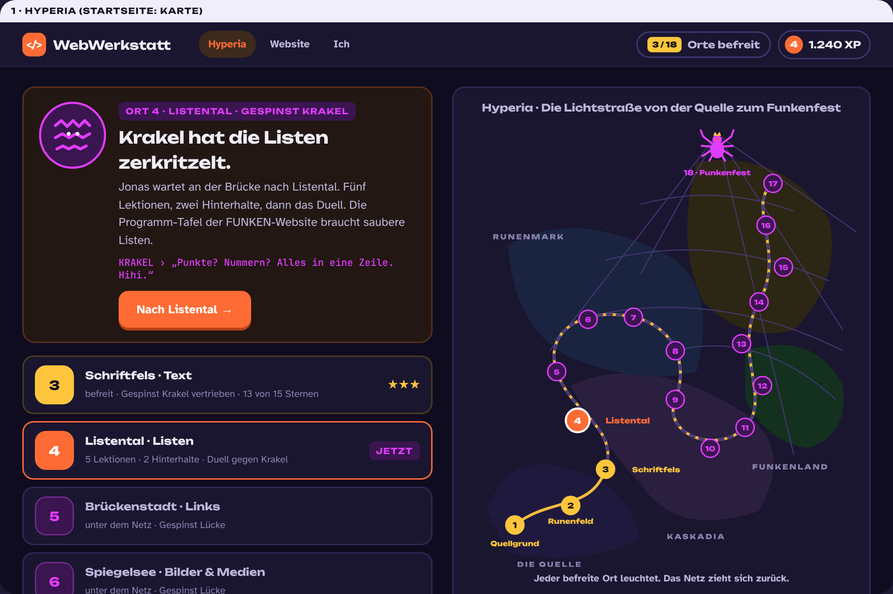
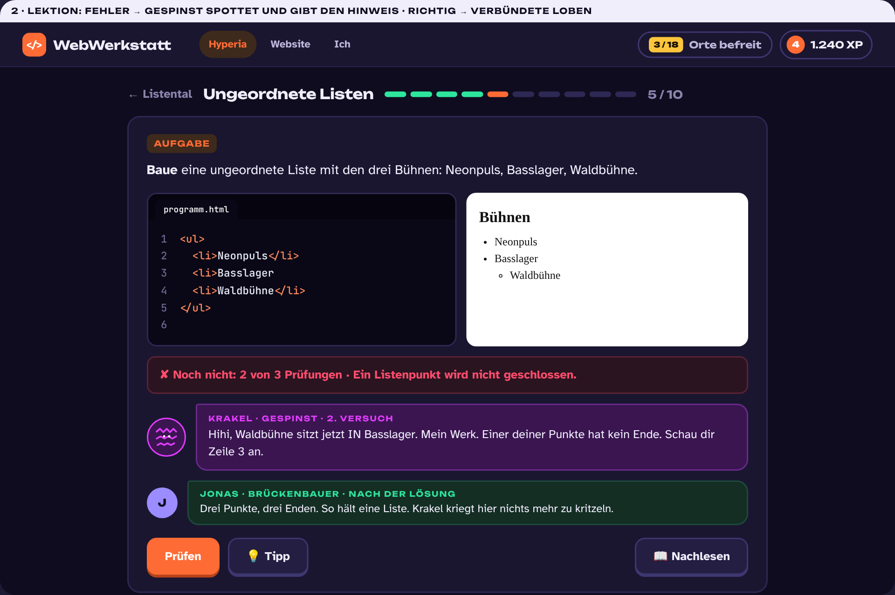
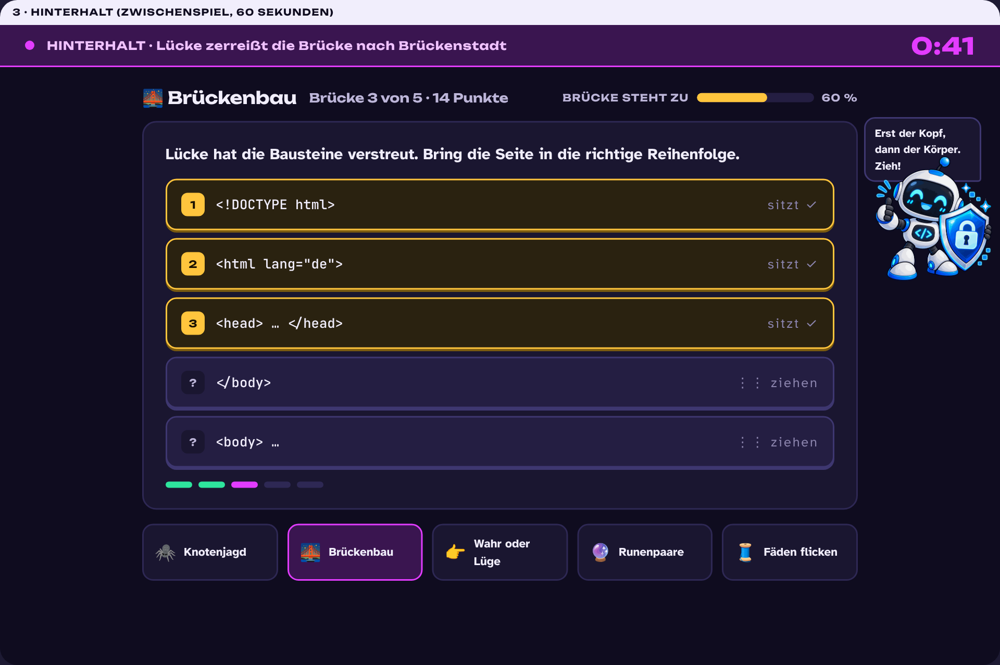
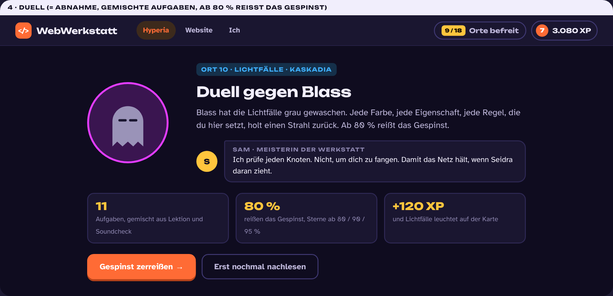
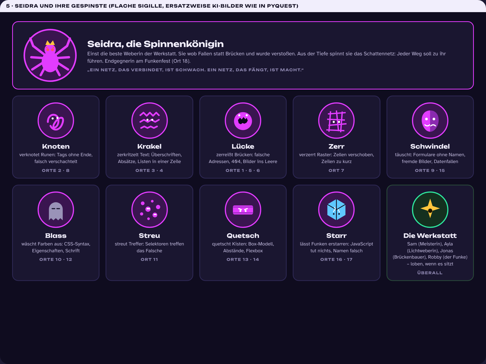
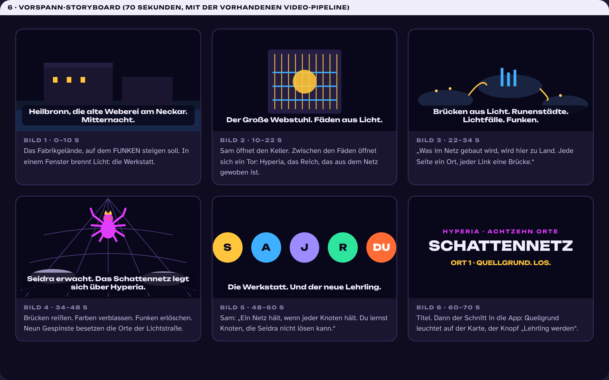
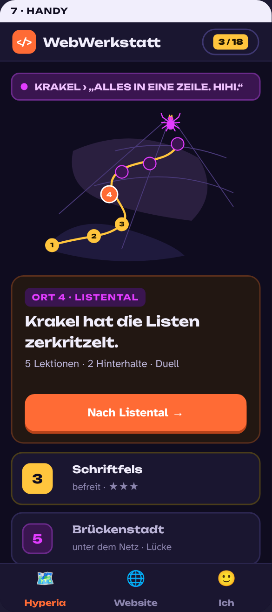

# SCHATTENNETZ – Vorschlag für die neue Story

Stand: 11.10.2026 · Status: **Vorschlag, nichts umgesetzt.** Ersetzt die abgelehnten Vorschläge SKYLINE und BLACKOUT.

Vorgabe: Fantasiewelt, **eine Gegnerin, mehrere Lakaien**, Aufbau wie bei PyQuest (Professor Null, seine Handlanger, je Kapitel eine Welt), aber eine **andere Geschichte**. PyQuest spielt in einer Akademie über den Wolken; ein Kern zerbricht in Fragmente, Welten werden gerettet. Nichts davon wird hier wiederholt.

> **Heilbronn, die alte Weberei am Neckar. Mitternacht.** Auf dem Gelände, wo FUNKEN steigen soll, brennt in einem Fenster Licht: die Werkstatt. Im Keller steht der Große Webstuhl. Zwischen seinen Fäden liegt **Hyperia**, das Reich, das aus dem Netz gewoben ist. Jede Seite ein Ort, jeder Link eine Brücke aus Licht, jede Farbe ein Strahl aus den Lichtfällen, jeder Funke ein Stück Leben.
> In der Tiefe erwacht **Seidra**. Einst die beste Weberin der Werkstatt, bis sie Fallen wob statt Brücken und verstoßen wurde. Jetzt ist sie die Spinnenkönigin, und sie spinnt das **Schattennetz**: Brücken reißen, Farben verblassen, Funken erlöschen. Neun **Gespinste**, aus Schattenseide gesponnen, besetzen die achtzehn Orte der Lichtstraße.
> Du bist der neue Lehrling. Sam, die Meisterin: „Ein Netz hält, wenn jeder Knoten hält. Du lernst Knoten, die Seidra nicht lösen kann.“

**Die große Herausforderung:** Die Lichtstraße von der Quelle bis zum Funkenfest zurückerobern, Ort für Ort, Gespinst für Gespinst. Am Ende wartet Seidra selbst.

## 1. Warum das trägt

- **Eine Gegnerin mit Gesicht und Motiv.** Seidra war eine von uns. Ihr Satz: „Ein Netz, das verbindet, ist schwach. Ein Netz, das fängt, ist Macht.“ Genau darum geht es im Web: Verbindung gegen Falle. Das ist Medienbildung ohne Zeigefinger.
- **Neun Lakaien, jeder ein Fehler.** Wie Nulls Handlanger tut jedes Gespinst genau das, was Lernende falsch machen: Knoten lässt Tags offen, Lücke zerreißt Links, Blass wäscht CSS aus, Starr friert JavaScript ein. Sie spotten bei Fehlern, geben dabei immer deutlichere Hinweise und ziehen sich zurück, wenn es sitzt.
- **Die Metapher stimmt fachlich.** HTML sind die Runen, aus denen Orte gebaut sind. CSS ist das Licht aus Kaskadia. JavaScript sind die Funken, die Dinge bewegen. Die Spinne gehört zum Web wie das Netz.
- **Eine Karte, die sich verändert.** Achtzehn Orte unter dem Netz; jeder befreite Ort leuchtet auf. Das ist das Bild, das man beim Öffnen der App sieht.
- **Action und Gefahr bleiben.** Hinterhalte mit Timer, Spott der Gespinste, Seidra, die ab Ort 10 die Lichtstraße abschneidet, ein Duell pro Ort, am Ende das Finale.

## 2. Die Welt: Hyperia

Fünf Regionen, achtzehn Orte, eine Straße. Die Blöcke sind die vorhandenen Lehrplan-Blöcke, die Ortsnamen greifen die heutigen Abnahme-Titel auf.

| Region | Fach | Orte (= Kapitel) |
|---|---|---|
| **Die Quelle** | Grundlagen | 1 Quellgrund (Wie das Web funktioniert) |
| **Die Runenmark** | HTML | 2 Runenfeld (Erste Schritte) · 3 Schriftfels (Text) · 4 Listental (Listen) · 5 Brückenstadt (Links) · 6 Spiegelsee (Bilder & Medien) · 7 Rasterfeste (Tabellen) · 8 Zonenmark (Struktur & Attribute) · 9 Zollhaus (Formulare) |
| **Kaskadia** | CSS | 10 Lichtfälle (CSS-Grundlagen) · 11 Spotwald (Selektoren) · 12 Letternkloster (Schrift & Text) · 13 Kistenhafen (Box-Modell) · 14 Schwebegärten (Flexbox) · 15 Siegelhalle (Recht im Web) |
| **Das Funkenland** | JavaScript | 16 Funkenschmiede (JavaScript-Start) · 17 Uhrwerk (JavaScript & die Seite) |
| **Das Festgelände** | Showtime | 18 Funkenfest (Finale gegen Seidra) |

**Der Rahmen:** Die Werkstatt steht in Heilbronn, auf dem alten Fabrikgelände am Neckar, wo FUNKEN stattfindet. Hinter dem Webstuhl liegt Hyperia. Was du im Netz baust, wird dort zu Land. So bleibt die FUNKEN-Website das Werkstück (Lektionen, Projekt-Etappen, Showtime unverändert), und die Geschichte spielt in der Fantasiewelt. Das Funkenfest in Hyperia ist das Spiegelbild von FUNKEN.

## 3. Seidra und die Gespinste

| Figur | Fallenart (der Fehler) | Orte | Spott-Beispiel (1. → 3. Versuch) |
|---|---|---|---|
| **Seidra**, Spinnenkönigin | alles, im Finale | 18 | „Jeder Weg führt zu mir.“ |
| **Knoten** | Tags ohne Ende, falsch verschachtelt | 2 · 8 | „Ein Tag auf, keiner zu. Hihi.“ → „Zähl die Enden.“ → „Zeile 3. Da fehlt `
`. Nimm den Tipp.“ |
| **Krakel** | Überschriften, Absätze, Listen zerkritzelt | 3 · 4 | „Alles in eine Zeile!“ → „Welches Tag macht einen Absatz?“ → … |
| **Lücke** | falsche Adressen, 404, Bilder ins Leere | 1 · 5 · 6 | „Die Brücke endet im Nichts.“ → „Schau auf `href`. Genau so geschrieben wie die Datei?“ |
| **Zerr** | Tabellenzellen verschoben, Zeilen zu kurz | 7 | „Eine Zelle zu wenig. Merkt eh keiner.“ |
| **Schwindel** | Formulare ohne Namen, fremde Bilder, Datenfallen | 9 · 15 | „Wer braucht ein Label? Wer braucht Erlaubnis?“ |
| **Blass** | CSS-Syntax, Eigenschaften, Schrift | 10 · 12 | „Grau ist auch eine Farbe.“ → „Doppelpunkt? Semikolon? Eins fehlt.“ |
| **Streu** | Selektoren treffen das Falsche | 11 | „Alle Absätze rot. Du wolltest nur einen? Pech.“ → „Punkt für Klasse, Raute für ID.“ |
| **Quetsch** | Box-Modell, Abstände, Flexbox | 13 · 14 | „Innen, außen, egal.“ → „`padding` ist innen, `margin` außen.“ |
| **Starr** | JavaScript tut nichts, Namen falsch, Ereignis fehlt | 16 · 17 | „Klick so oft du willst.“ → „Heißt die Variable wirklich so? Groß und klein zählt.“ |

**Die Werkstatt (Verbündete, loben bei richtigen Lösungen):** **Sam**, Meisterin, nimmt die Duelle ab. **Ayla**, Lichtweberin (CSS). **Jonas**, Brückenbauer (Links, Struktur). **Robby**, der Funke, ein kleines mechanisches Wesen (JavaScript, Tipps; die vorhandenen Robby-Bilder passen). Alle vier Namen stehen schon in den Lektionen, nur ihre Rollen ändern sich.

**Bilder:** Die Gespinste als flache Sigille (SVG, siehe Mockup 5), vom gleichen Schlag wie die bisherigen Crew-Embleme, in jeder Größe scharf und ohne externe Werkzeuge. Wenn du lieber gezeichnete Figuren willst wie in PyQuest, schreibe ich die Bildbeschreibungen (Pose, Stil, Farben) und die Übernahme-Skripte; die Bilder lässt du wie bei PyQuest erzeugen.

## 4. Die Mechaniken (fünf, nicht mehr)

1. **Die Karte.** Startseite = Hyperia. Oben die „Weiter“-Karte mit dem einen Knopf, darunter die Orte, rechts die Karte: befreit (gold), jetzt (orange), unter dem Netz (violett). Jeder befreite Ort leuchtet auf, das Netz zieht sich sichtbar zurück.
2. **Figuren in den Lektionen.** Fehler: Das Gespinst des Ortes spottet, von Versuch zu Versuch strenger und mit immer klarerem Hinweis (Reihenfolge, keine Zufallsauswahl). Richtig: Ein Verbündeter lobt. Genau das PyQuest-Prinzip, mit eigenem Text.
3. **Hinterhalte.** Nach jeder zweiten Lektion lauert ein Gespinst auf: 60 Sekunden, eine Geste, Timer. Fünf Spiele aus den vorhandenen Pools: **Knotenjagd** (Zeile mit dem Fehler antippen, bug-Pool), **Brückenbau** (Bausteine ordnen, order-Pool), **Wahr oder Lüge** (wischen, aus dem quiz-Pool), **Runenpaare** (Memory, pair-Pool), **Fäden flicken** (Lückentext, fill-Pool). Inhalt nur aus befreiten Orten, fällige Leitner-Karten zuerst, 0–3 Sterne. Vor jedem Duell ein Warm-up mit Aufgaben dieses Ortes.
4. **Duell = Abnahme.** Gemischte Aufgaben, ab 80 % reißt das Gespinst, Sam nimmt ab. Sterne ab 80 / 90 / 95 %. Danach: Ort leuchtet, Rückzugs-Satz des Gespinsts, nächster Ort.
5. **Finale.** Ort 18: Seidra. Zwölf Aufgaben über alles. Danach das Funkenfest: alle Orte leuchten, die Website im Vollbild, dein Name im Licht.

Kein Lebens-System, kein Zeitdruck außerhalb der Hinterhalte, kein Verlust von Fortschritt. Verloren heißt: nochmal.

## 5. Was vom bisherigen Stand bleibt

Lektions-Player, Nachlesen-Schublade, Spickzettel, Merksätze, Soundcheck (Leitner), Abnahme-Engine, Werkbank, Projekt-Etappen, Showtime, Lehrkraft-Modus, Lernbericht, Validator, Rauchtest, E2E, Video-Pipeline, Emblem-Engine (wird zur Sigil-Engine). Drei Bereiche: **Hyperia · Website · Ich**. Ein oranger Knopf pro Seite.

Gestrichen: Turnier, 18 Crews, Trash-Talk, Reaktionen, Trophäenwand, Ränge, Kombo, Tagesziel, Tages-Serie, Trainingslager-Seite, Dialog-Szenen. 37 Abzeichen werden 8 Meilensteine (eine Region befreit, Seidra besiegt, 100 Soundchecks, 50 Hinterhalt-Sterne, drei Duelle beim ersten Versuch, …).

## 6. Design

Dunkel, flach, zwei Signalfarben: **Gold** für Licht, Fortschritt und befreite Orte, **Violett** für Seidra und alles unter dem Netz. Orange bleibt der eine Knopf. Hintergrund tiefes Nachtviolett, Karten mit 2-px-Rand, keine Partikel, kein Blur. Die Karte und die Sigille sind SVG. Schrift: Unbounded (Titel), Atkinson Hyperlegible (Text), JetBrains Mono (Code und Gespinst-Zitate). Hell-Modus als Schalter unter „Ich“.

## 7. Mockups

## 8. Kosten und Plan

Inhalt: Die 18 Kapitel, 86 Lektionen, Pools, Abnahmen und die FUNKEN-Website bleiben. Angefasst werden 22 Lektionen mit Turnier-Bezug (78 Stellen), 3 mit Agentur-Bezug, die Abnahme-Einleitungen (Sam als Meisterin), die Story-Dateien und das Video. Neu geschrieben: `figuren.json` mit Vorstellung, Spott-Reihen und Rückzug für 9 Gespinste und Lob für 4 Verbündete, 18 Orts-Einleitungen, Seidras Auftritte.

| Phase | Inhalt | Aufwand |
|---|---|---|
| **0 · Trailer** | Storyboard-HTML für den 70-Sekunden-Vorspann, neue Musik, Render als MP4/WebM. Du siehst die Stimmung zuerst. | 0,5 Sitzung |
| **1 · Fundament** | Dunkles Design-System, drei Bereiche, Karte von Hyperia (SVG, 18 Orte, Zustände), „Ich“, Lektion und Duell im neuen Look, Turnier-Schicht raus, Store-Migration | 1,5 Sitzungen |
| **2 · Figuren** | Sigil-Engine (10 Figuren), Figuren-Engine in den Lektionen (Spott-Reihen bei Fehlern, Lob bei Lösung), `figuren.json` mit allen Texten | 1 Sitzung |
| **3 · Hinterhalte** | Spiel-Engine (Timer, Punkte, Sterne, Leitner-Auswahl), fünf Spiele, Knoten im Weg, Warm-up vor dem Duell | 1,5 Sitzungen |
| **4 · Story** | 18 Orts-Einleitungen, Seidra-Auftritte (Ort 1, 10, 15, 18), Finale mit Funkenfest, Text-Pass durch die betroffenen Lektionen und Abnahmen | 1 Sitzung |
| **5 · QA & Doku** | Validator, Rauchtest, E2E, Handy, Doku | 0,5–1 Sitzung |

Etwa 6 Sitzungen. Nach Phase 1 ist die App benutzbar, nach Phase 0 hast du den Trailer.

## 9. Deine Entscheidungen

1. **SCHATTENNETZ mit Seidra: ja?** Oder willst du eine andere Art Gegner (Hexenmeister, Drache, Maschine)?
2. **Bilder:** flache Sigille von mir (sofort, kostenlos, konsistent) oder gezeichnete Figuren wie in PyQuest (ich schreibe die Beschreibungen, du lässt sie erzeugen)?
3. **Verbündete:** Sam, Ayla, Jonas, Robby behalten (steht im Inhalt) oder neue Fantasie-Namen?
4. **Rahmen:** Werkstatt in Heilbronn mit Tor nach Hyperia (Empfehlung, die FUNKEN-Website bleibt wie sie ist) oder komplett Fantasie (dann müssen Heilbronn, Neckar und Festival an rund 500 Stellen umgeschrieben werden)?
5. **Trailer zuerst** rendern, bevor ich die App umbaue?
6. **Leben** wie in PyQuest? (Empfehlung: nein, Druck kommt aus Hinterhalten und Spott, nicht aus Verlusten.)
