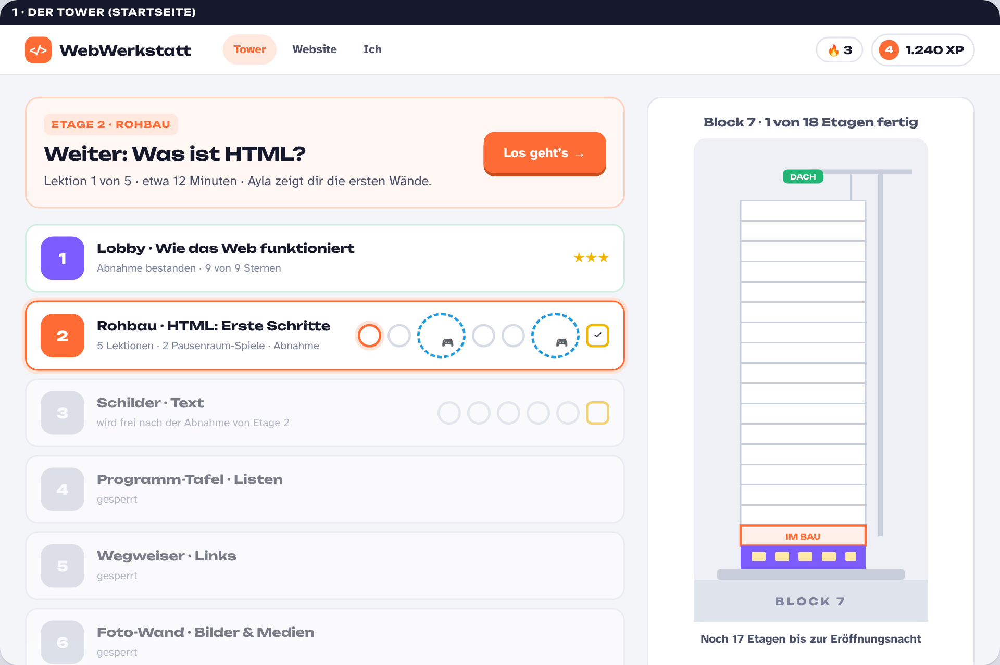
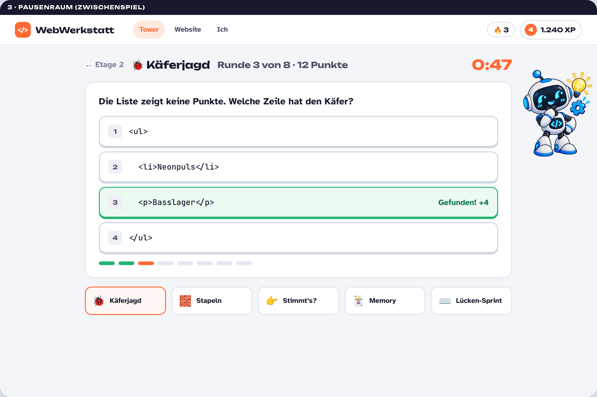
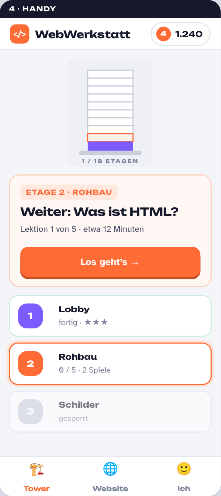

# Vorschlag: „SKYLINE“ – ein Neustart der Story, weniger Funktionen, flaches Design

Stand: 11.10.2026 · Status: **Vorschlag, noch nichts umgesetzt.** Du entscheidest, wie es weitergeht (Fragen am Ende).

## 1. Kurzfassung

- **Weg mit dem Turnier.** Kein WEBCUP, keine 18 Gegner-Crews, kein Trash-Talk, keine „die Website ist verschwunden“-Krise.
- **Neue Story „SKYLINE“:** Die Nachtschicht bekommt einen leeren 18-stöckigen Turm am Neckar („Block 7“) und baut ihn Etage für Etage aus – bis zur Eröffnungsnacht FUNKEN. Jede Etage ist ein Kapitel, jede Abnahme schaltet das Licht einer Etage ein. Am Ende leuchtet der ganze Turm und die Website geht live.
- **Weniger ist mehr:** 3 Bereiche (Tower · Website · Ich), auf jeder Seite genau ein großer Knopf „Weiter“. 37 Abzeichen, Ränge, Kombos, Tagesziel, Trophäenwand, Reaktionen und Dialog-Szenen fliegen raus.
- **Pausenraum statt Dialog-Zwischenspiele:** 5 kurze Spiele (je 60–90 Sekunden), die Gelerntes aus allen bisherigen Etagen wiederholen – zusätzlich zum Soundcheck (Leitner) in den Lektionen.
- **Flaches, helles Design:** große Karten, klare Farben pro Bauabschnitt, kein Glow, keine Partikel, Dark Mode als Schalter.
- **Kosten:** Die vorhandenen 18 Kapitel, 86 Lektionen, Pools, Abnahmen und die FUNKEN-Website bleiben. Die Abnahmen heißen heute schon „Fundament“, „Lichtpult“, „Stromkasten“ – die Bau-Metapher steckt bereits im Inhalt. Rund 4–5 Arbeitssitzungen.

Mockups (statisch, zum Anschauen): `docs/vorschlag/mockup.html` und die Bilder darunter.

## 2. Was du gesagt hast – und was daraus folgt

| Deine Vorgabe | Konsequenz im Vorschlag |
|---|---|
| Kein Turnier, keine fehlende Website | Positive Aufgabe statt Krise: etwas Großes **aufbauen**, nicht etwas retten |
| „Super coole, große Herausforderung“ | Ein sichtbares Ziel mit Endpunkt: 18 Etagen, Eröffnungsnacht, Licht an |
| Nicht zu viele Funktionen | Feature-Diät (Abschnitt 5): behalten, was Lernen trägt; streichen, was nur Dekoration ist |
| Zwischenspiele = lustige Spiele mit Wiederholung | Pausenraum mit 5 Mini-Spielen aus den vorhandenen Aufgaben-Pools (Abschnitt 7) |
| Flach, modern, cool, nicht überfordernd | Helles Design-System mit großen Karten, einer Akzentfarbe und einem Knopf pro Seite (Abschnitt 8) |
| „Immer wissen, wo sie draufdrücken müssen“ | Startseite = eine „Weiter“-Karte; Lektion = ein Schritt pro Seite; Navigation = 3 Tabs |

## 3. Drei Story-Ideen

### A · SKYLINE – 18 Etagen bis zur Eröffnungsnacht (Empfehlung)

**Prämisse.** Heilbronn, am Neckar steht „Block 7“: ein leerer Büroturm, 18 Etagen, seit Jahren dunkel. Die Stadt gibt ihn für ein Jahr an ein junges Kollektiv – die Nachtschicht. Bedingung der Stadt: In 18 Etagen entsteht ein Haus für das Schülerfestival FUNKEN, und jede Etage wird von der Bauleitung abgenommen. Am Ende steht die Eröffnungsnacht: Der Turm leuchtet, die Website geht live.

**Die große Herausforderung.** Vom dunklen Rohbau zum leuchtenden Turm. Auf der Startseite steht der Turm; jede abgenommene Etage geht an. Das ist das Spielziel, sichtbar bei jedem Öffnen der App.

**Die Metapher ist fachlich richtig:**

| Bauabschnitt | Etagen | Fach | Warum das passt |
|---|---|---|---|
| Lobby | 1 | Grundlagen | Hier kommt man an: Browser, Server, URL |
| Rohbau | 2–9 | HTML | Wände, Räume, Schilder – Struktur ohne Deko |
| Innenausbau & Licht | 10–15 | CSS | Farbe, Licht, Möbel, Abstände, Hausordnung |
| Strom & Technik | 16–17 | JavaScript | Schalter, Sensoren, Dinge passieren auf Knopfdruck |
| Dach | 18 | Showtime | Eröffnungsnacht, alles zusammen |

**Figuren.** Alle bleiben: **Sam** wird von der Jury zur Bauleitung (macht die Abnahmen, ist streng, aber auf unserer Seite). **Ayla** (Technik), **Robby** (Tipps, Erklärungen) und **Jonas** bleiben Crew. Keine Gegner, kein Trash-Talk. Die Spannung kommt aus dem Ziel, nicht aus Feinden.

**Etagen-Namen** (stehen fast alle schon als Abnahme-Titel im Inhalt):

1 Lobby · Info-Point · 2 Fundament · 3 Textbanner · 4 Programm-Tafel · 5 Wegweiser · 6 Foto-Wand · 7 Timetable · 8 Zonen · 9 Ticket-Schalter · 10 Lichtpult · 11 Spots · 12 Schriftzug · 13 Container · 14 Bühnen-Layout · 15 Sicherheitszentrale · 16 Stromkasten · 17 Schaltpult · 18 Dach · Showtime

**Was mit den Inhalten passiert.** Die FUNKEN-Website bleibt das Projekt: Sie ist die Website zur Eröffnungsnacht in Block 7. Alle 18 Kapitel, Lektionen, Pools und Abnahmen bleiben inhaltlich gleich. Zu ändern sind: 18 Lektionen mit „Turnier“-Bezug (73 Stellen), 6 Lektionen mit „verschwunden/abgeschaltet“ (7 Stellen), die Story-Dateien (intro, szenen, crews) und das Vorspann-Video. Das ist der günstigste Weg zu einer komplett neuen Story.

**Für 16–19 cool, weil:** sichtbarer Fortschritt (der Turm), echter Endpunkt (Eröffnungsnacht), eigenes Werk zum Herzeigen (die Website), kein Kinderton, kein Zwang zu Wettbewerb.

### B · NEULAND – Expedition in ein unbekanntes Gebiet

**Prämisse.** Die Crew erhält eine Karte, von der nur ein Zipfel sichtbar ist. Jedes Kapitel deckt eine Region auf (Nebel verschwindet), am Ende steht der Gipfel. Pausenraum = Lagerfeuer-Spiele. Figuren: Expeditionsleitung statt Bauleitung.

**Stärken:** Entdecker-Gefühl, hübsche Karten-Startseite. **Schwäche:** Die FUNKEN-Website passt nicht zu einer Expedition. Das Projekt müsste zum Expeditions-Blog werden – das sind 200 Stellen in den Projekt-Etappen und 61 Lektionen mit FUNKEN-Bezug. Etwa dreimal so teuer wie A, und die Metapher erklärt HTML/CSS/JS nicht.

### C · LAUNCH – 18 Sprints im Web-Studio

**Prämisse.** Die Nachtschicht ist ein kleines Web-Studio, FUNKEN ist der Kunde, Sam die Kundin. 18 Sprints bis zum Launch-Tag mit Countdown. Pausenraum = Kaffeeküche.

**Stärken:** Realistisch (Agentur, Kunde, Sprint – passt zum beruflichen Gymnasium), günstigste Variante, kaum Text-Änderungen. **Schwäche:** Weniger Spiel, weniger Bild. Ein Sprint-Board ist kein Turm, der aufleuchtet. Für die Zielgruppe eher „Praktikum“ als „Abenteuer“.

### Empfehlung

**A.** Es ist positiv statt krisenhaft, hat ein starkes Bild (der Turm), erklärt das Fach nebenbei (Rohbau → Innenausbau → Strom), nutzt die vorhandenen Abnahme-Titel und kostet wenig Inhalt. B wäre schöner anzusehen, kostet aber die Projekt-Geschichte; C ist sicher, aber nicht cool.

## 4. Story A im Detail

**Prolog (Vorspann-Video, 60–70 Sekunden, neu gerendert mit der vorhandenen Pipeline):**
Nacht über Heilbronn. Block 7 steht dunkel. Sam: „Die Stadt gibt uns den Block. Für eine Nacht. FUNKEN.“ Regel: 18 Etagen, jede wird abgenommen, jede Etage geht an. Crew-Vorstellung. Titel „SKYLINE“. Letztes Bild: Etage 1 leuchtet auf, „Lobby – los geht's“.

**Etagen-Briefing (ersetzt Anpfiff + Crew-Funk):** eine Karte mit 3–4 Sätzen am Anfang jeder Etage – was wird gebaut, was braucht die Website dafür. Ein Knopf: „Los geht's“. Überspringbar, jederzeit über die Etagen-Seite nachlesbar. Keine Dialog-Klickstrecken mehr.

**Lektionen:** unverändert im Aufbau (Erklären → Beispiel → Aufgabe → Soundcheck), mit Nachlesen-Schublade und Spickzettel wie jetzt.

**Pausenraum:** Spiel-Knoten im Etagenweg (siehe 7).

**Abnahme (ersetzt Match + Abpfiff):** wie jetzt (gemischte Aufgaben, ab 80 % bestanden), Sam als Bauleitung. Danach der Moment: Die Etage im Turm geht an (eine ruhige 0,6-Sekunden-Animation, kein Feuerwerk), ein Satz von Sam, Knopf „Nächste Etage“.

**Finale (Etage 18):** Alle Etagen leuchten, Website-Vorschau im Vollbild, „Eröffnungsnacht“-Karte mit Name und Sternen – das Ding zum Herzeigen.

## 5. Feature-Diät

| Behalten (trägt das Lernen) | Vereinfachen | Streichen |
|---|---|---|
| Lektions-Player (ein Schritt pro Seite) | **Spielerkarte → „Ich“**: Name, Level, XP, Sterne, 8 Meilensteine, Spielstand sichern/laden, Dark-Mode-Schalter | WEBCUP, Turnierplan, 18 Gegner-Crews, Embleme |
| Nachlesen-Schublade + Spickzettel + Merksätze | **Abzeichen 37 → 8 Meilensteine** (Lobby fertig, Rohbau fertig, Innenausbau fertig, Strom fertig, Eröffnungsnacht, 100 Soundchecks, 50 Pausenraum-Sterne, 3× Abnahme beim ersten Versuch) | Trash-Talk, Reaktionen, Trophäenwand, Trophäenkarten |
| Soundcheck (Leitner-Wiederholung) | **Vorspann**: ein Video, überspringbar, später unter „Ich“ nochmal anschaubar | Ränge, Werte, Kombo-Zähler, Tagesziel |
| Abnahme pro Etage (80 %) | **XP + Level** bleiben, aber ohne Bonus-Zoo: Lektion, Soundcheck, Pausenraum, Abnahme | Trainingslager als eigene Seite (geht im Pausenraum auf) |
| Projekt-Website mit Etappen + Showtime | **Sterne statt Abzeichen**: pro Lektion 1–3 Sterne (3 = ohne Musterlösung und höchstens ein Tipp) | Dialog-Szenen (Anpfiff, Crew-Funk, Abpfiff) |
| Spielstand sichern/laden, Lehrkraft-Modus + Lernbericht (versteckt unter „Ich“) | **Serie (Streak)**: optional, siehe Fragen | Tagesbonus, Volltreffer-Bonus |

Ergebnis: Lernende sehen **Turm, Website, Ich** – sonst nichts.

## 6. Navigation und Bildschirme

**Drei Tabs**, oben (Desktop) bzw. unten (Handy):

- **Tower** – Startseite. Oben die „Weiter“-Karte (genau ein Knopf), darunter die Etagen als Liste mit Knoten (Lektionen, Spiele, Abnahme), rechts der Turm.
- **Website** – die FUNKEN-Seite: Vorschau, Etappen, am Ende Showtime.
- **Ich** – Profil, Sterne, Meilensteine, Spielstand, Dark Mode, Lehrkraft-Modus (hinter einem Link).

**Regel: pro Seite ein primärer (oranger) Knopf.** Alles andere ist grau umrandet. Es gibt keinen Zustand, in dem Lernende nicht wissen, was als Nächstes dran ist – die „Weiter“-Karte sagt es immer.

### Mockups

*Startseite: „Weiter“-Karte, Etagenliste mit Knoten (orange = jetzt, gestrichelt blau = Pausenraum-Spiel, gelb = Abnahme), rechts der Turm.*

*Lektion: ein Schritt pro Seite, Fortschrittsbalken, Aufgabe mit Editor und Vorschau, Weiter / Tipp / Nachlesen.*

*Pausenraum: Käferjagd mit Timer, 8 Runden, danach Sterne. Unten die anderen Spiele.*

*Handy: dieselben drei Bereiche unten, eine Spalte, der Turm klein oben.*

## 7. Pausenraum – die Spiele

**Grundregeln (für alle Spiele gleich):**

- 60–90 Sekunden pro Runde, eine Eingabe-Geste (tippen, wischen oder ein Wort tippen). Kein Tutorial nötig.
- Inhalt **nur aus bereits gelernten Etagen** (plus abgeschlossene Lektionen der aktuellen). Fällige Leitner-Karten kommen zuerst – der Pausenraum ist Wiederholung in Spielform, kein neuer Stoff.
- 0–3 Sterne pro Runde, kleine XP (10–25), damit Spiele die Lektionen nicht ersetzen.
- Am Ende jeder Runde: „Das hast du wiederholt“ – drei Konzepte mit Link zum Spickzettel.
- **Im Weg**: nach jeder zweiten Lektion ein Spiel-Knoten (eine Runde, ~1 Minute, Sterne egal) und vor jeder Abnahme ein „Warm-up“ mit Aufgaben dieser Etage. **Frei**: jederzeit über die Pausenraum-Karte auf der Tower-Seite, auch die Spiele früherer Etagen.

**Die fünf Spiele zum Start** (alle aus vorhandenen Pools, kein neuer Inhalt nötig):

| Spiel | Mechanik | Quelle | Beispiel |
|---|---|---|---|
| 🐞 **Käferjagd** | 4 Codezeilen, eine hat den Fehler – antippen. 8 Runden gegen die Uhr | bug-Pool (83 Aufgaben) | „Die Liste zeigt keine Punkte. Welche Zeile hat den Käfer?“ |
| 🧱 **Stapeln** | Bausteine in die richtige Reihenfolge ziehen (oder nacheinander antippen) | order-Pool (26) + Codezeilen aus Beispielen | `<!DOCTYPE html>` … `<body>` … in Ordnung bringen |
| 👉 **Stimmt's?** | Aussage lesen, nach rechts (stimmt) oder links (stimmt nicht) wischen. 20 Aussagen in 60 s | quiz-Pool (116) – aus jeder Frage werden eine wahre und eine falsche Aussage | „`<li>` darf direkt in `<body>` stehen.“ |
| 🃏 **Memory** | 8 Paare umdrehen: Tag ↔ Bedeutung, Eigenschaft ↔ Wirkung | pair-Pool (41) | `font-weight` ↔ „Strichstärke“ |
| ⌨️ **Lücken-Sprint** | Das fehlende Wort tippen, 90 s, so viele wie möglich | fill-Pool (74) | `<a ___="seite.html">` → `href` |

**Später (Phase 2b, optional):** 🎯 Selektor-Scharfschütze (ein Selektor, eine Mini-Seite: das richtige Element antippen), 📦 Flex-Lieferdienst (Kisten mit `justify-content`/`align-items` an den Zielort bringen).

**Didaktisch:** Die Spiele decken genau die Wissensarten ab, die in den Lektionen trainiert werden (Fehler finden, Reihenfolge, Begriff zuordnen, Regel beurteilen, Syntax abrufen). Weil die Items aus den Leitner-Fächern kommen, verstärken sie die geplante Wiederholung, statt sie zu ersetzen.

## 8. Design-System (flach)

- **Hell als Standard**, Dark Mode als Schalter unter „Ich“ (mit `prefers-color-scheme` als Vorbelegung).
- **Farben:** Hintergrund `#f4f5f9`, Karten weiß mit 2-px-Rand `#e3e6ee`, Tinte `#15192b`. Eine Akzentfarbe Orange `#ff6b35` für den primären Knopf und „jetzt“. Bauabschnitte haben je eine Farbe: Lobby violett `#7c5cff`, Rohbau orange, Innenausbau blau `#1f9bde`, Strom gelb `#f2b705`, Dach grün `#22b573`. Erfolg grün, Fehler rot – sonst nichts.
- **Schrift:** Unbounded (Überschriften, Zahlen), Atkinson Hyperlegible (Text, gut lesbar, auch bei Leseschwäche), JetBrains Mono (Code). Alle schon im Projekt.
- **Bausteine:** Karte (18 px Radius), Primärknopf (orange, 3 px „Kante“ unten, einer pro Seite), Sekundärknopf (grau umrandet), Chip (Bauabschnitt), Weg-Knoten (Kreis / gestrichelt / Quadrat), Fortschrittsbalken (Segmente), Turm (SVG, 18 Etagen, an/aus).
- **Bewegung:** 150–250 ms für Zustände, 600 ms für „Etage geht an“. Keine Partikel, kein Glow, kein Blur, kein Parallax. `prefers-reduced-motion` wird beachtet.
- **Handy:** eine Spalte, Tabs unten, Knöpfe mindestens 48 px hoch, Editor und Vorschau untereinander.
- **Figuren:** Robby bleibt (Tipps, Pausenraum), Sam/Ayla/Jonas als kleine runde Avatare in Briefing und Abnahme – keine Comic-Kulissen mehr.

## 9. Was wiederverwendet wird

Vom aktuellen Stand bleibt mehr als die Hälfte: Lektions-Player, Prüf-Engine, Werkbank (Editor/Vorschau), Leitner-Soundcheck, Nachlesen-Schublade, Spickzettel, Merksätze, Projekt-Etappen, Showtime, Lehrkraft-Modus, Lernbericht, Validator, Rauchtest, E2E-Spieler, Video-Pipeline (Storyboard → Chromium → ffmpeg, Musik-Synth, Untertitel).

Gelöscht werden: Turnierplan, Match-Ansicht, Crew-Embleme, Trophäenkarten, Reaktionen, Dialog-Szenen-Engine, Trainingslager-Seite, `turnier.css`, `story.css`, `crews.json`, `szenen.json`, Ränge/Kombo/Tagesziel im Store (mit Migration, Fortschritt bleibt erhalten).

## 10. Umsetzungsplan

| Phase | Inhalt | Aufwand |
|---|---|---|
| **1 · Fundament** | Neues CSS (flach), 3 Tabs, Tower-Startseite mit Turm und Etagenliste, „Ich“-Seite, Lektion im neuen Look, Abnahme im neuen Look, Turnier-Schicht entfernen, Store-Migration, UI-Texte „Runde/Crew“ → „Etage“ | 1,5 Sitzungen |
| **2 · Pausenraum** | Spiel-Engine (Timer, Punkte, Sterne, Leitner-Auswahl, Ergebnis-Karte), die 5 Spiele, Spiel-Knoten im Weg, Warm-up vor Abnahme | 1,5 Sitzungen |
| **3 · Story & Video** | Etagen-Briefings (18 × 3–4 Sätze), Sam als Bauleitung, Text-Pass durch 18 Lektionen mit Turnier-Bezug und 6 mit Krisen-Bezug, neues Storyboard + Render des Vorspanns, Finale-Bildschirm | 1 Sitzung |
| **4 · QA & Doku** | Validator anpassen, Rauchtest + E2E, Handy-Check, README/KONZEPT/DIDAKTIK/STATUS aktualisieren | 0,5–1 Sitzung |

Gesamt: etwa 4–5 Sitzungen. Nach Phase 1 ist die App schon benutzbar (ohne Spiele, mit Platzhalter-Knoten), du kannst also früh reinschauen.

## 11. Entscheidungen, die ich von dir brauche

1. **Story:** A SKYLINE (Empfehlung), B NEULAND oder C LAUNCH – oder eine Mischung?
2. **Name:** App bleibt „WebWerkstatt“, Story heißt „SKYLINE“ – oder soll der Turm-Name „Block 7“ nach vorn? (Empfehlung: WebWerkstatt bleibt, „SKYLINE“ als Titel des Vorspanns und der Startseite.)
3. **Helles Design als Standard** mit Dark-Mode-Schalter? (Empfehlung: ja.)
4. **Spiele zum Start:** alle fünf, oder erst drei (Käferjagd, Stimmt's?, Lücken-Sprint) und die anderen später? (Empfehlung: alle fünf, sie nutzen vorhandene Pools.)
5. **Serie (Streak) behalten?** Im Unterricht mit 1–2 Terminen pro Woche reißt eine Tages-Serie ständig – das demotiviert eher. (Empfehlung: streichen; Sterne und der Turm reichen als Motivation.)
6. **Abnahme-Schwelle:** 80 % behalten? (Empfehlung: ja, mit 3 Sternen ab 95 %, 2 ab 90 %, 1 ab 80 %.)
7. **Vorspann-Stimmen:** wie jetzt Musik + Untertitel, oder willst du Sprecherstimmen aufnehmen (lassen)? (Empfehlung: erst Untertitel; Stimmen lassen sich später einbauen.)
8. **Crew-Name:** „Nachtschicht“ behalten? (Empfehlung: ja, steht schon im Inhalt.)

Sobald du entschieden hast, starte ich mit Phase 1.
